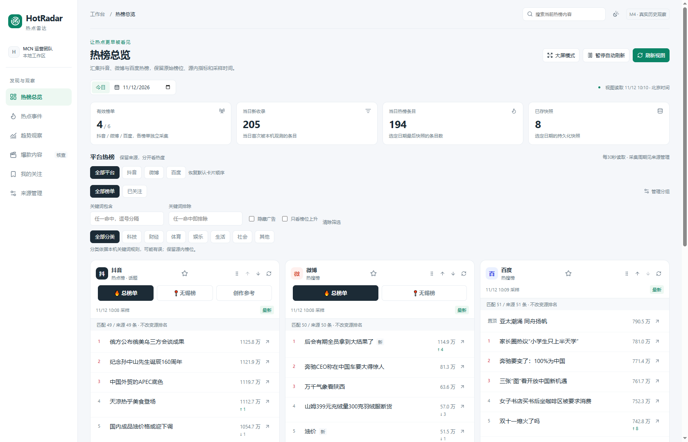
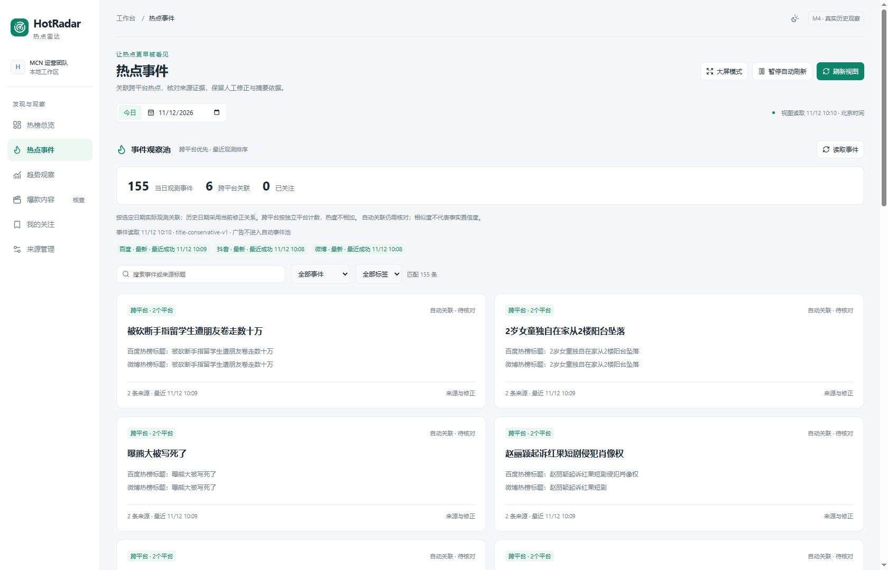
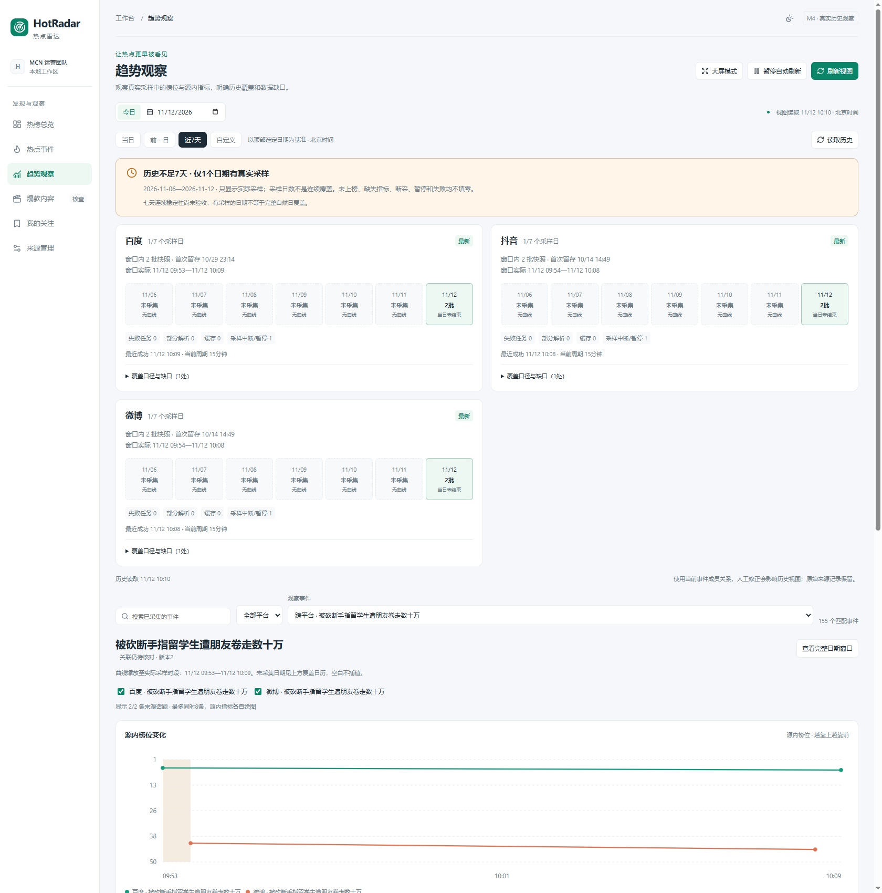
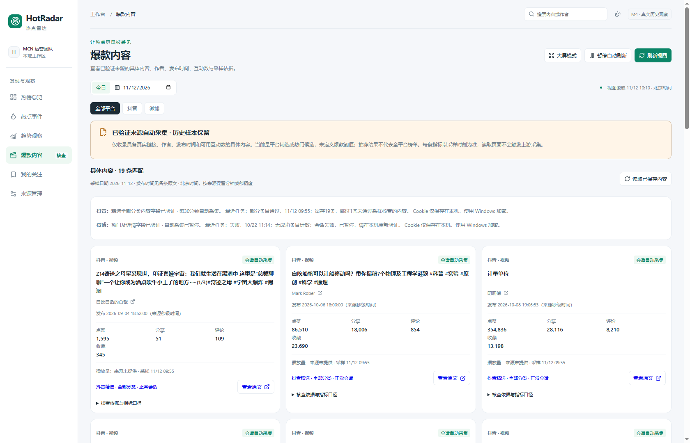

# HotRadar 热点雷达

HotRadar 是面向 MCN 运营团队的本地热点与趋势情报工作台。它汇集抖音、微博和百度的热榜，帮助团队发现今天值得关注的话题、核对跨平台来源，并用最近七天的实际采样观察变化。当前版本聚焦热点发现、分析与追溯。

[查看 v1.2.0 发布](https://github.com/Tom8the/HotRadar/releases/tag/v1.2.0)

## 核心功能

| 功能 | 可以做什么 |
| --- | --- |
| 热榜总览 | 并排查看抖音热榜、微博热搜、百度实时热搜，按平台、分类或关键词筛选。支持查看无锡榜、历史快照、来源原文和源内指标。 |
| 热点事件 | 查看可能指向同一事件的跨平台话题及其来源摘录。支持人工合并、拆分和恢复，保留操作记录及原始快照。 |
| 趋势观察 | 默认查看近七天，支持自定义日期。分别查看榜位和各来源的指标变化，追溯实际采样点，识别缺采、失败和覆盖不足。 |
| 爆款内容 | 查看抖音精选和微博热门的候选视频或帖子，核对作者、发布时间、互动指标、采样时间和原文链接。 |
| 关注与大屏 | 关注榜单和事件，管理来源启停及采集频率，用深色大屏查看趋势并控制轮播。 |

## 界面截图

截图来自实际运行的 HotRadar，画面中的日期和采样时间使用北京时间。

### 热榜总览



### 热点事件



### 趋势观察



### 爆款内容



## 本地运行

需要 Windows PowerShell、Git、Python 3.12、uv、Node.js 24/npm 和可用的 Docker Compose。

```powershell
git clone https://github.com/Tom8the/HotRadar.git
Set-Location HotRadar
.\scripts\setup.ps1
.\scripts\init-project.ps1
```

初始化脚本生成本机数据库配置、启动 PostgreSQL 16、应用迁移、注册来源并执行首轮采集。随后在三个 PowerShell 窗口中分别执行以下命令。

```powershell
.\scripts\dev-backend.ps1
.\scripts\dev-frontend.ps1
.\scripts\dev-worker.ps1
```

- 工作台 [http://127.0.0.1:18811](http://127.0.0.1:18811/)
- API 文档 [http://127.0.0.1:18810/docs](http://127.0.0.1:18810/docs)
- 可通过 `.\scripts\create-desktop-shortcut.ps1` 创建 Windows 桌面启动入口。详见[本地开发与运行](docs/Development.md)。

## 数据口径

- 每条观测保留来源链接、实际采样时间和指标口径。平台热度按源展示，缺失值保持为空，历史从成功采集起累积。
- 默认话题榜每 15 分钟采集一次，页面每 30 秒读取数据库。近七天是查询窗口，实际覆盖以页面中的成功采样日期为准。
- 具体内容与部分同城来源可在“来源管理 → 采集授权”弹窗中扫码、输入验证码或拖动滑块，验证后启用采集。会话按来源加密保存，Windows 和 Linux 均可使用。详见[采集授权与服务器迁移](docs/Development.md#采集授权与服务器迁移)。

## 技术与文档

Next.js、React 和 TypeScript 提供工作台。Python 3.12、FastAPI、SQLAlchemy、Alembic 和 PostgreSQL 支撑采集、入库、查询与追溯。独立 Worker 管理周期任务。

- [产品需求](docs/PRD.md)与[开发路线](docs/Roadmap.md)
- [系统架构](docs/Architecture.md)与[数据来源及字段口径](docs/DataSources.md)
- [本地开发与运行](docs/Development.md)与[依赖和技术参考](docs/References.md)
